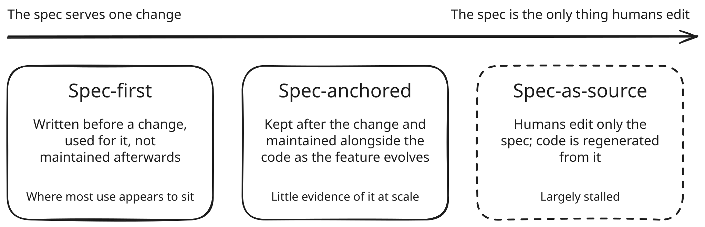
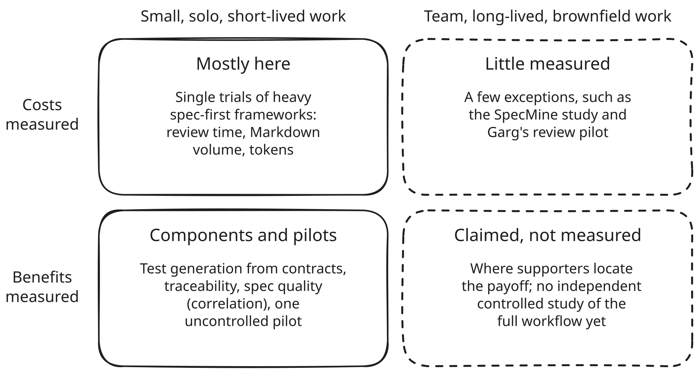
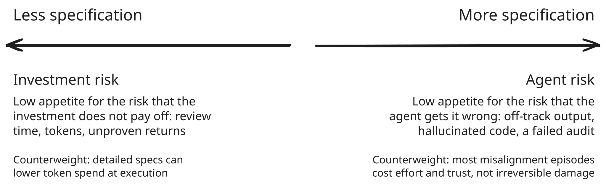

import BlogPostPicture from '@components/picture/BlogPostPicture.astro';

import cardPuncher from './Card_puncher_-_NARA_-_513295.jpg';
import margaretHamilton from './Margaret_Hamilton_-_restoration.jpg';
import ibmCardStorage from './IBM_card_storage.NARA.jpg';

In [one test reported in November 2025](https://blog.scottlogic.com/2025/11/26/putting-spec-kit-through-its-paces-radical-idea-or-reinvented-waterfall.html), an engineer used a spec-driven toolkit to build a feature. The agent produced 689 lines of code and 2,577 lines of Markdown describing it. Whether that ratio is waste or the point is the argument at the centre of spec-driven development.

Mention spec-driven development in a discussion about coding agents, and two positions appear almost at once. One side sees an expensive ritual that slows teams down and has not yet proven its promise. The other sees the obvious next step: if agents write the code, the specification becomes the thing that matters.

This post looks at where spec-driven development (SDD) stands as of October 2026. It is a report, not a verdict, and the judgement is left to the reader. I should declare an interest: I use spec-driven development in my own work and find it valuable, though I'm still weighing whether the investment pays off in every context.

**As of October 2026, spec-driven development solves real problems, but it is not free. The evidence for both camps is thinner than either admits, and whether it pays depends on the work, the team and its appetite for two kinds of risk.** One is the risk that the agent gets it wrong; the other is the risk that the investment does not pay off.

## The two camps

The case for SDD is easiest to understand in the words of the people who built the tools. When GitHub [released Spec Kit in September 2025](https://github.blog/ai-and-ml/generative-ai/spec-driven-development-with-ai-get-started-with-a-new-open-source-toolkit/), Den Delimarsky framed the shift like this:

> We're moving from 'code is the source of truth' to 'intent is the source of truth.'

The argument is simple. A vague prompt forces a model to guess; a written specification puts the constraints where the agent can use them. If code becomes cheap to generate, the durable asset is the description of what the code should do.

The case against is just as easy to state. Colin Eberhardt of Scott Logic, the engineer behind that test, reported in November 2025 on building the same feature twice, once with Spec Kit and once by working iteratively with an agent, and concluded:

> The simple fact is I am a lot more productive without SDD, around ten times faster.

The "ten times" is his own estimate from a single test. But it captures the sceptical position well: SDD adds documents to write and review, it costs time and tokens, and nobody has yet shown that the extra effort pays for itself.

## What spec-driven development actually is

In its current form, SDD means writing a structured specification before an AI coding agent starts work, and letting the agent turn that specification into a technical plan, a task list and finally code. The specification usually lives as Markdown files in the repository, next to the code it describes.

That definition covers a lot of ground, and the term is used loosely. Birgitta Böckeler, who wrote [an early and influential analysis](https://martinfowler.com/articles/exploring-gen-ai/sdd-3-tools.html) of the first tools, observed in October 2025 that the term _"isn't very well defined yet, and it's already semantically diffused."_ She proposed three levels, a taxonomy many later writers use:

- **Spec-first:** a specification is written before an AI-assisted change, used for that change, and not maintained afterwards.
- **Spec-anchored:** the specification is kept after the change and maintained alongside the code as the feature evolves.
- **Spec-as-source:** humans edit only the specification, and code is regenerated from it.

_The three levels of spec-driven development, after Birgitta Böckeler. Diagram for this article._

Where the evidence allows, the claims below say which level they concern, because a cost measured at one level says little about another.

Most real use appears to sit at the first level, which the repository study discussed below also suggests. The third level appears to have stalled. Tessl, its best-known champion, [launched its framework in closed beta](https://tessl.io/blog/announcing-tessls-products-to-unlock-the-power-of-agents) in September 2025. The framework never reached general availability, as far as public sources show, and in January 2026 the company [repositioned itself around agent skills](https://tessl.io/blog/skills-are-software-and-they-need-a-lifecycle-introducing-skills-on-tessl), packaged instructions that extend what an agent can do.

Böckeler works at Thoughtworks, and its [Technology Radar](https://www.thoughtworks.com/radar) makes a similar point: the terms around SDD and harness engineering (the practice of investing in the environment around an agent) are sometimes used inconsistently or overlap in meaning. Böckeler and the Radar both reflect one company's view. Independently, InfoQ's [2026 Culture & Methods panel](https://www.infoq.com/articles/culture-trends-2026/) grouped SDD with harness engineering and guardrails as, in many respects, rebrandings of decades-old practices. A separate [InfoQ retrospective on technology adoption](https://www.infoq.com/articles/adoption-curve-twenty/) suggested that SDD might be the next architectural paradigm, or might turn out to be 2026's version of Model-Driven Architecture.

<BlogPostPicture
    src={cardPuncher}
    alt="A woman operating a Hollerith pantograph punch for the 1940 US census"
/>

_Preparing punched cards for the 1940 US census, around 1940. U.S. Census Bureau / National Archives, public domain, via [Wikimedia Commons](https://commons.wikimedia.org/wiki/File:Card_puncher_-_NARA_-_513295.jpg)._

The overlap is also visible in the tools themselves. [Anthropic's guidance for Claude Code](https://code.claude.com/docs/en/best-practices) describes a pattern in which the agent interviews you, writes the result to a SPEC.md file, and a fresh session implements it. That is a light form of spec-first SDD, presented as ordinary practice for plan mode, in which the agent first explores the code and proposes a plan for approval before it edits anything. [OpenAI's write-up on harness engineering](https://openai.com/index/harness-engineering/) checks execution plans into the repository as first-class artefacts without calling them specifications at all. The lightest form of SDD is being absorbed into the general practice of working with agents.

Underneath sits an older layer: project-wide files such as [Spec Kit's constitution](https://github.com/github/spec-kit), [Kiro's steering files](https://kiro.dev/docs/specs/) and CLAUDE.md are written conventions for agents, and they matter for the same reasons [written coding conventions](/blog/the-renaissance-of-written-coding-conventions/) always have.

## State of play, October 2026

The tools are young and still changing quickly. The snapshot below, listed alphabetically, was checked on 23 October 2026 and will soon be out of date.

| Tool                                                                                                                         | What it is                                                                     | Version and signals (23 Oct 2026)                                           |
| ---------------------------------------------------------------------------------------------------------------------------- | ------------------------------------------------------------------------------ | --------------------------------------------------------------------------- |
| [BMAD Method](https://github.com/bmad-code-org/BMAD-METHOD)                                                                  | Open source SDD framework                                                      | v6.12.4, ~54.5k stars; v7 in preview alpha                                  |
| [Conductor](https://developers.googleblog.com/evolving-spec-driven-development-conductor-now-supports-antigravity/) (Google) | Open source; moved from a Gemini CLI extension to a plugin                     | ~3.8k stars                                                                 |
| GSD                                                                                                                          | Open source SDD framework                                                      | Original repo (~64k stars) archived in June 2026; successor gsd-core ~10.8k |
| [Kiro](https://kiro.dev/blog/general-availability/) (AWS)                                                                    | Commercial IDE; requirements, design and tasks files                           | GA since November 2025; IDE 1.4.26                                          |
| Native plan modes                                                                                                            | Built into Claude Code and Cursor                                              | Vendor guidance, not separate tools                                         |
| [OpenSpec](https://github.com/Fission-AI/OpenSpec)                                                                           | Open source; change proposals with delta specs (specs of what one change adds) | v1.14.3, ~72.8k stars                                                       |
| [Spec Kit](https://github.com/github/spec-kit) (GitHub)                                                                      | Open source; phased specify, plan, tasks, implement workflow                   | v1.2.3, ~142.5k stars; 1.0 in August 2026                                   |
| [Superpowers](https://github.com/obra/superpowers)                                                                           | Open source; a general agentic skills framework, not SDD-specific              | ~304k stars                                                                 |
| Tessl                                                                                                                        | Commercial; repositioned around agent skills                                   | No general-availability release found                                       |

Star counts measure attention, not adoption, and the table is not a ranking; Superpowers, the most-starred project, is a general skills framework. Maturity signals are modest. Spec Kit reached 1.0 in August 2026, and a [post by its lead maintainer](https://www.manorrock.com/blog/2026/08/21/spec_kit_turns_one.html) marking the release described it this way:

> We shipped 1.0.0 of an experiment, on purpose.

The analyst view is cautious. Thoughtworks placed the SDD technique [in its _Assess_ ring](https://www.thoughtworks.com/radar/techniques/spec-driven-development) in November 2025 (it is no longer on the current edition) and [Spec Kit](https://www.thoughtworks.com/radar/languages-and-frameworks/github-spec-kit), [OpenSpec](https://www.thoughtworks.com/en-us/radar/tools/openspec) and Superpowers there in April 2026. Gartner published [an Innovation Insight](https://www.gartner.com/en/documents/7492453) in February 2026, Forrester now [names SDD as a capability](https://www.forrester.com/blogs/launching-the-agentic-development-platforms-vendor-landscape-q3-2026/) of agentic development platforms, and InfoQ places it among innovators and early adopters. What nobody has published is adoption data: no survey reports what share of teams use SDD. The picture is of a field with much attention, modest maturity and no measured adoption.

Neutrality in the next two sections means one standard for both sides, not equal weight for evidence of unequal strength. A single test with a described method is weak evidence, and a vendor self-report without one is weaker still, whichever side either supports.

## The overhead claim, tested

The sceptical camp's evidence is concrete and mostly points in one direction. Much of it comes from single tests of heavy spec-first frameworks on small features, several of them run in late 2025 on tools and models that have since changed.

The best-documented cost is review. In Eberhardt's spec-first test with Spec Kit (November 2025), the agent ran for 33 minutes 30 seconds; review then took about three and a half hours, most of it covering the 2,577 lines of Markdown from the opening. His iterative rebuild, the second build of a feature he now knew, took 8 minutes of agent time, 15 minutes of code review and 9 minutes of testing and fixes. He also conceded that the quality of the code Spec Kit produced was "just fine".

Böckeler saw Kiro turn a small bug into four user stories with sixteen acceptance criteria in October 2025, and her verdict on the Markdown the tools produced was blunt:

> To be honest, I'd rather review code than all these markdown files.

<BlogPostPicture
    src={margaretHamilton}
    alt="Margaret Hamilton standing beside the printed listings of the Apollo guidance software"
/>

_Margaret Hamilton beside the listings of the Apollo guidance software her team wrote, 1969. These are code listings, not specifications. Draper Laboratory, restored by Adam Cuerden; public domain in the US and released for any use by the copyright holder, via [Wikimedia Commons](https://commons.wikimedia.org/wiki/File:Margaret_Hamilton_-_restoration.jpg)._

[François Zaninotto](https://marmelab.com/blog/2025/11/12/spec-driven-development-waterfall-strikes-back.html) of Marmelab, writing in November 2025, cited a developer for whom Spec Kit produced eight files and 1,300 lines of text to display the current date in a time-tracking app. In a review pilot with five reviewers, [reported in InfoQ](https://www.infoq.com/articles/when-spec-driven-development-pays-off/) by Nitin Garg (September 2026), those given specifications took about 48 minutes, against 27 for those who saw only the code. They tied 81% of their findings to a named specification clause, which code-only reviewers could not do, while the share of issues found stayed flat.

Token cost is the second complaint, and here the evidence points in both directions. [A Google study](https://arxiv.org/abs/2608.17177) (Tufano, August 2026) found the spec-driven agent used 38% more tokens but caught more bugs, so tokens per bug found rose by about 16%; it studied test generation from pre- and post-conditions, not an SDD workflow. [Jakub Smékal's August 2026 study](https://arxiv.org/abs/2608.25399) found that cutting a full task specification to a bare user story raised token spend by 29.7%. It used one model (Kimi K3), found no measurable effect on solve rate, and compared levels of specification, not SDD with plan mode.

Detailed specifications can cost tokens to write and save tokens to execute. [Matthew Wilson of Instil](https://instil.co/blog/spec-driven-development-is-dead-long-live-plan-mode) (June 2026) put Spec Kit's cost at several times that of the equivalent plan-mode flow, without figures, and a single user reported in January 2026 [hitting plan limits in under an hour](https://github.com/github/spec-kit/issues/1492), though one commenter reported a milder experience.

The third concern is a false sense of control. Böckeler often saw the agent ignore some of its instructions; once, it ignored notes that described existing classes and regenerated them as duplicates. A [community extension](https://github.com/datastone-inc/spec-kit-verify-tasks) for Spec Kit now exists specifically to catch _phantom completions_, tasks marked as done that were never implemented. A large August 2026 study of SDD in practice by [Agarwal and colleagues](https://arxiv.org/abs/2608.25202) started from the SpecMine corpus of spec files from 73,030 repositories and added practitioner interviews. Across the corpus, 81.5% of spec files have only one commit, and 98.3% of those with a recorded history have a single author. Most inline review comments on specs (68.5%) come from bots. That is consistent with mostly spec-first use, and it offers little evidence of the maintained, living specification that the spec-anchored level depends on.

<BlogPostPicture
    src={ibmCardStorage}
    alt="Pallets of boxed punched cards in a federal records warehouse"
/>

_Punched cards in storage at the Federal Records Center in Alexandria, Virginia, November 1959. National Archives, public domain, via [Wikimedia Commons](https://commons.wikimedia.org/wiki/File:IBM_card_storage.NARA.jpg)._

A further objection concerns learning. Kent Beck, [quoted by Martin Fowler](https://martinfowler.com/fragments/2026-01-08.html) in January 2026, put it most sharply:

> This encodes the (to me bizarre) assumption that you aren't going to learn anything during implementation that would change the specification.

Zaninotto made the same argument against big design up front, the practice of fixing a full design before building. One answer is that the objection targets a whole spec written in advance: OpenSpec's delta specs describe only what one change adds, and at the spec-anchored level the spec is revised as the feature evolves. The SpecMine study's single-commit figure cannot tell abandoned specs from per-change delta specs, so this answer is plausible but not yet observed at scale. [Thomas Johnson](https://beyondruntime.substack.com/p/spec-driven-development-the-rebranded), who concedes that SDD is in part a rebranding of big design up front, argues that the economics behind big design up front have flipped.

Even so, the critics concede more than their headlines suggest. Böckeler wrote that the general principle of spec-first is valuable in many situations. Zaninotto granted that SDD helps agents stay on task. The overhead is consistently reported, across several single tests, Garg's review pilot and the SpecMine study's repository data. What the evidence shows less clearly is how large it is beyond small, solo, short-lived features, and how much of it survives newer tools.

## The promise, tested

The supporters' case is mostly an argument from principle. Its ambition reaches beyond spec-first, towards specs that are kept or that become the source itself. Sean Grove gave its strongest version in his June 2025 talk [_The New Code_](https://lawwu.github.io/transcripts/8rABwKRsec4.html):

> Because code itself is actually a lossy projection from the specification.

If that is true, the specification deserves the care we give to source code. Tessl's [Simon Maple](https://tessl.io/blog/from-code-centric-to-spec-centric/) pushed the idea to spec-as-source, describing the spec as the document the code is derived from at all times, while conceding many open questions. Vendor stories illustrate the case but do not prove it: [Kiro's team reports](https://kiro.dev/blog/one-year/) that Siemens built a service with Kiro in two weeks with a single architect, and [an AWS case study for PKFARE](https://aws.amazon.com/solutions/case-studies/pkfare/) claims sixty-fold faster prototyping. Both are vendor self-reports without a described method.

The measured evidence is more modest. Each study needs to be read for what it actually tested; "component" below means it tested one ingredient of SDD, not the full workflow:

- Test generation from contracts (component): in the Google study of 90 single-file bugs, an agent that first wrote pre- and post-conditions caught 63.2% of bugs within five attempts against 53.4% for the baseline, a gain of 9.8 percentage points. At one attempt the difference was not significant. This tests design-by-contract reasoning, not an SDD workflow.
- Traceability (component): a June 2026 [preprint (traceSDD)](https://arxiv.org/abs/2606.30689) required generated code to cite requirement IDs and caught 86 - 88% of injected, fake requirement references with no false positives, at the cost of less deterministic output. The hallucinations were synthetic.
- Specification quality in general (correlation): an October 2026 [study (EPIC)](https://arxiv.org/abs/2610.07534) of 114 repositories found that projects in the top third for specification quality spent 11.8% of their commits on bug fixes, against 20.4% in the bottom third. This is an association; it does not show cause.
- A workflow pilot (spec-first SDD, uncontrolled): [Sabry Farrag's May 2026 preprint](https://arxiv.org/abs/2605.01160) followed 14 engineers on three projects for four months before and after adopting Spec Kit. It reported median lead time falling from 8 - 12 to 6 - 9 days and hotfixes from 3 - 5 to 1 - 2 per sprint. There was no control group, and the author himself treats the results as indicative only.
- Underspecified agents (specification in general): a July 2026 [benchmark (Ji)](https://arxiv.org/abs/2607.02294) varied how underspecified the instructions were and found that, across five agent setups, 55.8 - 67.8% of runs violated at least one boundary. In other words, agents tend to guess rather than stop.

None of these results can be attributed to SDD as such rather than to plan mode plus tests. They show that written specifications, contracts and traceability have measurable effects. They do not show that a specify-plan-tasks workflow is the best way to get them. Garg's separate code-generation experiments, reported in the same InfoQ article without a described design, add a further caution: on easier tasks, he argues, most of the gain people attribute to specifying first comes from the model simply reasoning more, not from the specification.

The popular figures are weaker still. The claim of a "75% Reduction in Cycle Time" comes from a contract-testing vendor's [case study (Specmatic)](https://specmatic.io/case-studies/case-study-cdd-cut-api-cycle-time-by-75-percent/) about API contracts, not AI agents. A "3 - 10x higher first-pass success rate" comes from [a 2026 guide by BCMS](https://www.thebcms.com/blog/spec-driven-development/) that cites only unlinked "early adopter reports from GitHub and AWS". The Gartner statistics quoted in vendor blogs, such as [Opsera's](https://opsera.ai/blog/spec-driven-development), point to no Gartner report anyone can check. By the standard set out above, they count for very little.

Finally, the intuition that better specifications fix agents deserves a check. [A large study of 20,574 real agent sessions](https://arxiv.org/abs/2605.29442) (Tang, 2026) found that underspecified instructions caused 15.4% of misalignment episodes. The largest cause, at 36.5%, was the agent failing to follow instructions it had been given. Specifications address one cause of agent failure. Verification still has to address the rest. This is the same point [an earlier post here](/blog/more-agents-same-mythical-month/) made from another direction: written intent only helps if someone keeps it consistent and checks the work against it.

## What the evidence cannot settle yet

Much of what matters is missing. No independent controlled study compares a full SDD workflow with plan-mode or iterative work on cost, defects or drift. Nothing measures cost or benefit over months of maintenance, across teams, or in large legacy codebases.

The evidence is also uneven in a way that is easy to misread. **The costs of the workflow have numbers; its promise is argued mostly from principle, with numbers only for components or uncontrolled pilots.** That asymmetry may say as much about what is easy to measure as about SDD. With few exceptions, such as the SpecMine study and Garg's review pilot, the overhead is measured where supporters do not claim the payoff, and the payoff is claimed where little has been measured.

_Where the evidence sits, as of October 2026: a summary of the sources reviewed for this article. Diagram for this article._

Self-reported gains make this harder. [METR's 2025 study](https://metr.org/blog/2025-07-10-early-2025-ai-experienced-os-dev-study/) found experienced developers slower with AI while they believed they were faster, a result METR now flags as out of date. METR describes [its 2026 follow-up data](https://metr.org/blog/2026-02-24-uplift-update/) as _"an unreliable signal of the current productivity effect of AI tools"_. That concerns AI productivity in general. SDD's own evidence shows the same difficulty: in the SpecMine study's interviews, SDD users reported more reliable agents but could not separate that from improvements in the underlying models.

## What decides it: risk appetite and the shape of the work

One position recurs in the commentary; I will call it the middle path: specifications scaled to the task, backed by executable checks, kept with the code and revised as the team learns. It matters who says what. Anthropic's Claude Code guidance scales the process to the size and uncertainty of the change, from no plan through plan mode to an interview plus a SPEC.md file, with checks the agent can run. Critics such as Wilson of Instil and writers such as [Hidde de Smet](https://hiddedesmet.com/the-hidden-costs-of-spec-driven-development), who sorts changes into full-spec, light-spec and no-spec lanes, recommend something similar. Thoughtworks praises OpenSpec for its focus on delta specs rather than a complete specification up front.

This is a recommendation from named parties, each of whom defines "light" in their own way. It is not a measured convergence: there is no adoption data; Spec Kit, one of the heaviest frameworks, is still growing in features and extensions.

The strongest sceptical position goes further: SDD is already superseded. Wilson puts Spec Kit's cost at several times that of plan mode for the same scope of work, without figures, and [Kevin Davison](https://www.quevin.ai/blog/2026-09-23-the-spec-was-never-the-goal) argues that the niche for tools like Spec Kit narrows with every model release. The nearest evidence for that claim is a small controlled [preprint by Arquimedes Canedo](https://arxiv.org/abs/2608.21747) (90 tests, August 2026), which found that structured, code-close specifications help weaker models most and matter little for frontier models. Thoughtworks similarly advises teams to keep re-evaluating the need for SDD tooling as native agent capabilities grow.

This is a serious position. Its proponents concede limits, though: Wilson keeps durable specifications where they are used many times. And the component studies show measurable effects from written specifications and contracts. Whether getting those effects needs dedicated SDD tooling, or only a plan that is written down and kept, is the open question. Teams already working in a native plan mode can ask exactly that: what a framework adds beyond a committed plan file.

If the evidence does not settle the question, something else has to. One useful framing is risk, in two senses that pull in opposite directions. A team with little appetite for the risk of the agent getting it wrong, whether that means off-track output, hallucinated code or a failed audit, has reason to want more specification. A team with little appetite for the risk of the investment not paying off, in review time, tokens and unproven returns, has reason to want less. Each side has a counterweight. Most misalignment episodes are less dramatic than the worry about agent error suggests: in Tang's sessions, 90.5% of them cost effort and trust rather than causing irreversible damage. And detailed specifications are not pure cost: in Smékal's single-model study, which compared levels of specification rather than workflows, they lowered token spend at execution. [Paul O'Brien](https://www.doit.com/blog/spec-driven-development-with-kiro-ai-code-ownership), writing for the consultancy DoiT, put the trade-off plainly: SDD is slower, and the question is whether a team can afford the alternative.

_Two kinds of risk pull in opposite directions. Diagram for this article._

Risk appetite is one factor among several. The published decision frameworks, from de Smet's lanes to [Augment Code's write-or-skip table](https://www.augmentcode.com/guides/what-is-spec-driven-development), frame much of the decision around two questions: how expensive a wrong interpretation is to undo, and whether someone else must understand and approve the reasoning before a change ships. Beyond those, the research points to a handful of task and team factors:

- Task size and clarity: Anthropic's guidance for its own tool gives the most concrete sizing rule:

    > If you could describe the diff in one sentence, skip the plan.

    At the other end, Böckeler doubted SDD suits large features that are still very unclear, which echoes Zaninotto's argument against big design up front.

- Spec longevity: a spec used once is a cost. Wilson of Instil keeps specs that outlive one implementation, such as public APIs and decision records, and specs in regulated domains, because they are paid for once and used many times.
- Model capability: the small controlled preprint discussed above found that structured specifications help weaker models most. From his code-generation experiments, Garg locates the payoff in hard, multi-constraint work done by a capable but imperfect model.
- Review capacity: every spec is also something to review. For a team already short of review time, the extra Markdown will be the first review cost it notices.
- Engineering practice: Thoughtworks observes that engineers with strong clean-coding and architectural practices get the most value, a pattern [Simon Willison describes](https://simonwillison.net/2025/Oct/7/vibe-engineering/) for AI tools in general: they amplify existing expertise. SDD is likely to inherit the discipline of the team that uses it, much as [AI platforms inherit their engineering culture](/blog/your-ai-platform-will-inherit-your-engineering-culture/).

Two contexts change the calculation. In regulated work, [ASPICE](https://www.ul.com/sis/resources/process-swe-4), [DO-178C](https://www.parasoft.com/learning-center/do-178c/requirements-traceability/), [ISO 26262](https://www.mathworks.com/company/technical-articles/how-to-use-simulink-for-iso-26262-projects.html) and [IEC 62304](https://www.promenadesoftware.com/blog/fda-iec62304-software-documentation) all expect traceability between requirements, design and tests in some form, according to published summaries of the standards, and requirement IDs that trace through tasks can contribute to it. De Smet notes that where an audit trail already demands a written rationale, a full spec adds little extra burden, because it formalises a process the team already pays for. But the regulatory consultancy [Innolitics argues](https://innolitics.com/articles/ai-generated-code-fda-clearance/) that compliance lives in the evidence around the code rather than in the method. No regulator guidance on LLM coding tools was found.

In brownfield work, several Thoughtworks teams experimenting with Spec Kit do so mostly on existing systems. For that setting, Hari Krishnan, [writing in InfoQ](https://www.infoq.com/articles/enterprise-spec-driven-development/), recommends specifying incrementally, near the area of change. On his site, [intent-driven.dev](https://intent-driven.dev/blog/2026/03/10/spec-driven-development-brownfield/), he adds that specs reverse-engineered from existing code look plausible but diverge from what the code really does. [OpenSpec's documentation](https://github.com/Fission-AI/OpenSpec/blob/main/docs/concepts.md) describes its delta specs as designed for that kind of work.

None of these frameworks has been tested as a decision rule.

## Questions to ask before adopting

A few questions help a team make the decision honestly:

- Which problem are we trying to solve: agents going off-track, context lost between sessions, alignment with stakeholders, or audit traceability?
- How long will this spec live, and who will keep it current once the code changes?
- How expensive is a wrong interpretation to reverse in this part of the system?
- Where do our agent failures come from today: unclear intent, or missing verification?
- How much review capacity do we have, for Markdown as well as for code?
- How will we know whether it worked: lead time, defects and review effort, or self-reported speed?

InfoQ's editors summed up the state of the field in June 2026:

> Spec-driven and context-driven development will either be transformative or a footnote, and we probably do not yet know which.

That uncertainty is the honest position today, and it is why SDD is worth keeping an eye on. **Whether it pays depends on the work, the team and its appetite for two kinds of risk, and that judgement belongs to each team.**

## Used resources

- [Spec-driven development with AI: Get started with a new open source toolkit - Den Delimarsky, GitHub Blog](https://github.blog/ai-and-ml/generative-ai/spec-driven-development-with-ai-get-started-with-a-new-open-source-toolkit/)
- [Putting Spec Kit Through Its Paces: Radical Idea or Reinvented Waterfall? - Colin Eberhardt, Scott Logic](https://blog.scottlogic.com/2025/11/26/putting-spec-kit-through-its-paces-radical-idea-or-reinvented-waterfall.html)
- [Understanding Spec-Driven-Development: Kiro, spec-kit, and Tessl - Birgitta Böckeler, martinfowler.com](https://martinfowler.com/articles/exploring-gen-ai/sdd-3-tools.html)
- [Thoughtworks Technology Radar (Vol. 34)](https://www.thoughtworks.com/radar)
- [Thoughtworks Radar: Spec-driven development](https://www.thoughtworks.com/radar/techniques/spec-driven-development)
- [Thoughtworks Radar: GitHub Spec Kit](https://www.thoughtworks.com/radar/languages-and-frameworks/github-spec-kit)
- [Thoughtworks Radar: OpenSpec](https://www.thoughtworks.com/en-us/radar/tools/openspec)
- [InfoQ Culture & Methods Trends Report 2026](https://www.infoq.com/articles/culture-trends-2026/)
- [The Technology Adoption Curve, Twenty Years On - Renato Losio and Dio Synodinos, InfoQ](https://www.infoq.com/articles/adoption-curve-twenty/)
- [Best practices for Claude Code - Anthropic](https://code.claude.com/docs/en/best-practices)
- [Plan Mode - Cursor docs](https://cursor.com/docs/agent/plan-mode)
- [Harness engineering: leveraging Codex in an agent-first world - OpenAI](https://openai.com/index/harness-engineering/)
- [Skills on Tessl - Guy Podjarny, Tessl](https://tessl.io/blog/skills-are-software-and-they-need-a-lifecycle-introducing-skills-on-tessl)
- [Announcing Tessl's products - Guy Podjarny, Tessl](https://tessl.io/blog/announcing-tessls-products-to-unlock-the-power-of-agents)
- [From code-centric to spec-centric - Simon Maple, Tessl](https://tessl.io/blog/from-code-centric-to-spec-centric/)
- [GitHub Spec Kit](https://github.com/github/spec-kit)
- [Spec Kit turns one - Manfred Riem, manorrock.com](https://www.manorrock.com/blog/2026/08/21/spec_kit_turns_one.html)
- [OpenSpec](https://github.com/Fission-AI/OpenSpec)
- [BMAD Method](https://github.com/bmad-code-org/BMAD-METHOD)
- [Superpowers](https://github.com/obra/superpowers)
- [Kiro is generally available - Kiro blog](https://kiro.dev/blog/general-availability/)
- [Kiro changelog](https://kiro.dev/changelog/)
- [Specs - Kiro docs](https://kiro.dev/docs/specs/)
- [One year of Kiro - Deepak Singh, Kiro blog](https://kiro.dev/blog/one-year/)
- [PKFARE case study - AWS](https://aws.amazon.com/solutions/case-studies/pkfare/)
- [Evolving spec-driven development: Conductor now supports Antigravity - Google Developers Blog](https://developers.googleblog.com/evolving-spec-driven-development-conductor-now-supports-antigravity/)
- [Agentic Software Development Takes The Lead - Diego Lo Giudice, Forrester](https://www.forrester.com/blogs/agentic-software-development-takes-the-lead-from-code-assistants-to-orchestrated-sdlc-agents/)
- [Launching the Agentic Development Platforms Vendor Landscape, Q3 2026 - Diego Lo Giudice, Forrester](https://www.forrester.com/blogs/launching-the-agentic-development-platforms-vendor-landscape-q3-2026/)
- [Innovation Insight: Spec-Driven Development - Gartner](https://www.gartner.com/en/documents/7492453)
- [Spec-Driven Development: The Waterfall Strikes Back - François Zaninotto, Marmelab](https://marmelab.com/blog/2025/11/12/spec-driven-development-waterfall-strikes-back.html)
- [Fragments: January 8, 2026 - Martin Fowler](https://martinfowler.com/fragments/2026-01-08.html)
- [Spec-driven development: the rebranded BDUF - Thomas Johnson](https://beyondruntime.substack.com/p/spec-driven-development-the-rebranded)
- [Spec-driven development is dead, long live plan mode - Matthew Wilson, Instil](https://instil.co/blog/spec-driven-development-is-dead-long-live-plan-mode)
- [Excessive Token Usage with Claude Code - github/spec-kit issue #1492](https://github.com/github/spec-kit/issues/1492)
- [spec-kit-verify-tasks - datastone-inc](https://github.com/datastone-inc/spec-kit-verify-tasks)
- [When Spec-Driven Development Pays off - Nitin Garg, InfoQ](https://www.infoq.com/articles/when-spec-driven-development-pays-off/)
- [Grounding AI Agents in Contracts: An Empirical Evaluation of Spec-Driven Test Generation - Tufano](https://arxiv.org/abs/2608.17177)
- [Can your AI agent be cheaper? Effects of task specifications on token spend - Jakub Smékal](https://arxiv.org/abs/2608.25399)
- [Spec-Driven Development as Prescribed and as Practiced - Agarwal](https://arxiv.org/abs/2608.25202)
- [Citation Discipline in Spec-Driven Development - Subham Panda](https://arxiv.org/abs/2606.30689)
- [The EPIC Framework for Spec-Driven Development - Claudino](https://arxiv.org/abs/2610.07534)
- [The Productivity-Reliability Paradox: Specification-Driven Governance - Sabry E. Farrag](https://arxiv.org/abs/2605.01160)
- [Coding Agents Are Guessing - Ji](https://arxiv.org/abs/2607.02294)
- [How Coding Agents Fail Their Users - Tang](https://arxiv.org/abs/2605.29442)
- [Architecture as Capability Equalizer for Coding Agents - Arquimedes Canedo](https://arxiv.org/abs/2608.21747)
- [The New Code - Sean Grove, AI Engineer World's Fair 2025](https://lawwu.github.io/transcripts/8rABwKRsec4.html)
- [We are Changing our Developer Productivity Experiment Design - METR](https://metr.org/blog/2026-02-24-uplift-update/)
- [Measuring the Impact of Early-2025 AI on Experienced Open-Source Developer Productivity - METR](https://metr.org/blog/2025-07-10-early-2025-ai-experienced-os-dev-study/)
- [Case Study: 75% Reduction in Cycle Time for APIs - Specmatic](https://specmatic.io/case-studies/case-study-cdd-cut-api-cycle-time-by-75-percent/)
- [Spec-Driven Development (SDD): The Definitive 2026 Guide - BCMS](https://www.thebcms.com/blog/spec-driven-development/)
- [Spec-Driven Development: Specs Beat Prompts - Opsera](https://opsera.ai/blog/spec-driven-development)
- [The hidden costs of spec-driven development - Hidde de Smet](https://hiddedesmet.com/the-hidden-costs-of-spec-driven-development)
- [What Is Spec-Driven Development? A Complete Guide - Augment Code](https://www.augmentcode.com/guides/what-is-spec-driven-development)
- [Spec-Driven Development with Kiro: AI Code Ownership - Paul O'Brien, DoiT](https://www.doit.com/blog/spec-driven-development-with-kiro-ai-code-ownership)
- [The Spec Was Never the Goal - Kevin P. Davison](https://www.quevin.ai/blog/2026-09-23-the-spec-was-never-the-goal)
- [Vibe engineering - Simon Willison](https://simonwillison.net/2025/Oct/7/vibe-engineering/)
- [Spec-Driven Development - Adoption at Enterprise Scale - Hari Krishnan, InfoQ](https://www.infoq.com/articles/enterprise-spec-driven-development/)
- [Spec-Driven Development with Brownfield Projects - Hari Krishnan, intent-driven.dev](https://intent-driven.dev/blog/2026/03/10/spec-driven-development-brownfield/)
- [OpenSpec concepts - Fission AI](https://github.com/Fission-AI/OpenSpec/blob/main/docs/concepts.md)
- [How to Get Your AI-Generated, Vibe-Coded Medical Device FDA-Cleared - Yujan Shrestha, Innolitics](https://innolitics.com/articles/ai-generated-code-fda-clearance/)
- [Automotive SPICE SWE.4 Guide - UL Solutions](https://www.ul.com/sis/resources/process-swe-4)
- [Requirements Traceability Matrix for DO-178C Compliance - Parasoft](https://www.parasoft.com/learning-center/do-178c/requirements-traceability/)
- [How to Use Simulink for ISO 26262 Projects - MathWorks](https://www.mathworks.com/company/technical-articles/how-to-use-simulink-for-iso-26262-projects.html)
- [FDA and IEC 62304 Software Documentation - Promenade Software](https://www.promenadesoftware.com/blog/fda-iec62304-software-documentation)
- [Card puncher, 1940 US census (public domain image, U.S. Census Bureau via the National Archives, NAID 513295) - Wikimedia Commons](https://commons.wikimedia.org/wiki/File:Card_puncher_-_NARA_-_513295.jpg)
- [Margaret Hamilton beside the Apollo guidance software listings (public domain in the US, Draper Laboratory; restoration by Adam Cuerden) - Wikimedia Commons](https://commons.wikimedia.org/wiki/File:Margaret_Hamilton_-_restoration.jpg)
- [Punched card storage, Federal Records Center, Alexandria, Virginia, 1959 (public domain image, National Archives, NAID 12169529) - Wikimedia Commons](https://commons.wikimedia.org/wiki/File:IBM_card_storage.NARA.jpg)
